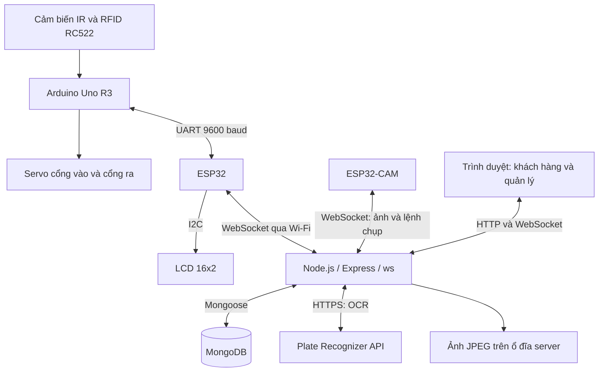

# Smart Parking | Last_Parking

**Mô hình bãi giữ xe thông minh tích hợp IoT, RFID, camera nhận diện biển số và web quản lý.**

Dự án kết nối Arduino Uno R3, ESP32 và ESP32-CAM với máy chủ Node.js để theo dõi 4 vị trí đỗ, ghi nhận lượt xe ra/vào, tính phí và cập nhật trạng thái lên giao diện web qua WebSocket.

Đây là sản phẩm nghiên cứu khoa học sinh viên tại **Học viện Công nghệ Bưu chính Viễn thông, cơ sở TP.HCM**, năm học **2025–2026**. Báo cáo tổng kết tháng 10/2025 mang tên *Thiết kế và thi công mô hình bãi giữ xe thông minh có thể theo dõi, quản lý từ xa qua thiết bị di động*.

> **Trạng thái:** mô hình nghiên cứu và demo quy mô nhỏ. Báo cáo ghi nhận kết quả kiểm thử của nhóm; bản source hiện có trên GitHub còn thiếu module và cần đồng bộ trước khi chạy lại. Phần [Giới hạn hiện tại](#giới-hạn-hiện-tại) liệt kê các điểm đã đối chiếu với code.

## Bài toán và phạm vi

Bãi giữ xe cần biết còn bao nhiêu chỗ, kiểm soát đúng phương tiện ra/vào và lưu lịch sử để tra cứu. Dự án xây dựng một mô hình kết hợp dữ liệu cảm biến, mã thẻ RFID và ảnh biển số với web đặt chỗ, thay vì chỉ điều khiển barie riêng lẻ.

Phạm vi mô hình gồm **4 vị trí A1–A4**, cổng vào và cổng ra dùng servo, giao diện khách hàng và giao diện quản lý. Người dùng truy cập bằng trình duyệt trên máy tính hoặc thiết bị di động. Chưa có ứng dụng mobile riêng; khả năng quản lý từ xa qua Internet cần hoàn thiện thêm.

## Tính năng

| Nhóm | Chức năng |
| --- | --- |
| Tài khoản | Đăng ký, đăng nhập; băm mật khẩu bằng bcrypt; server tạo JWT và lưu thông tin người dùng trong session |
| Đặt chỗ | Tạo mã đặt chỗ 6 chữ số, lưu MongoDB, giảm số chỗ khả dụng, tự hủy booking đang chờ sau 30 giây trong demo |
| Kiểm soát xe | Đọc thẻ RFID đã đăng ký, xử lý lượt vào/ra và gửi phản hồi điều khiển cổng |
| Cảm biến | Thu thập trạng thái có xe/trống tại 4 vị trí bằng cảm biến hồng ngoại |
| Camera và OCR | Chụp ảnh bằng ESP32-CAM, truyền ảnh về server, gọi Plate Recognizer để nhận diện biển số |
| Đối chiếu biển số | So sánh biển số lúc vào và lúc ra; gửi cảnh báo và phản hồi từ chối ra khi không khớp trong nhánh OCR thành công |
| Lịch sử và phí | Lưu thời gian, ảnh, biển số, trạng thái lượt xe; tính phí theo thời gian đỗ |
| Giao diện web | Xem trạng thái bãi, lịch sử ra/vào, camera và gửi lệnh điều khiển cổng |
| Kết nối | WebSocket truyền hai chiều giữa server, thiết bị và trình duyệt; ESP32 có cơ chế kết nối lại |

**Các giới hạn cần hiểu đúng:** thời gian giữ chỗ 30 giây mô phỏng yêu cầu 30 phút trong báo cáo. OCR sử dụng API bên ngoài, không phải mô hình AI do nhóm tự huấn luyện. Tính phí chưa đồng nghĩa với tích hợp thanh toán điện tử. Giao diện quản lý hiện chưa có cơ chế phân quyền đầy đủ.

## Kiến trúc hệ thống



| Thành phần | Trách nhiệm |
| --- | --- |
| Arduino | Đọc cảm biến/thẻ RFID, lưu danh sách thẻ trong EEPROM, xử lý trạng thái cổng và điều khiển servo |
| ESP32 | Cầu nối UART với Arduino và WebSocket với server; cập nhật LCD; xử lý phản hồi từ server |
| ESP32-CAM | Nhận lệnh chụp, mã hóa ảnh JPEG thành Base64, chia ảnh thành các chunk để gửi; hỗ trợ truyền khung hình |
| Server | Điều phối sự kiện, gọi OCR, ghi nhận lượt xe, tính phí, quản lý booking và phát cập nhật tới trình duyệt |
| MongoDB | Lưu người dùng, booking và lượt RFID; ảnh được lưu riêng trên filesystem |
| Trình duyệt | Hiển thị giao diện Handlebars, gửi HTTP request và nhận sự kiện WebSocket bằng JavaScript |

Server HTTP và WebSocket dùng chung một HTTP server và một cổng. WebSocket trong đường xử lý chính sử dụng thư viện **`ws`**; việc `socket.io` có trong dependencies không có nghĩa hệ thống đang dùng Socket.IO cho luồng này.

### Hai nguồn trạng thái chỗ đỗ

Cảm biến cung cấp trạng thái vật lý từng vị trí. Trong `statusManager.js`, số chỗ khả dụng trên server được tính theo:

```text
availableSlots = totalSlots - số lượt RFID ACTIVE - số booking pending
```

Hai nguồn này có thể lệch nhau khi lượt xe chưa hoàn tất, thiết bị mất kết nối hoặc sự kiện xử lý lặp. Đây là điểm cần đối soát khi phát triển hệ thống thực tế.

## Luồng hoạt động

### 1. Xe vào bằng RFID

1. Arduino đọc UID của thẻ, kiểm tra danh sách thẻ được phép và trạng thái xe/chỗ đỗ cục bộ.
2. Arduino gửi thông điệp `RFID_DATABASE:...` qua UART cho ESP32.
3. ESP32 chuyển thành JSON `rfid_access`, gửi server qua WebSocket.
4. Nếu camera đang online, server gửi `capture_request` cho ESP32-CAM.
5. Camera chụp ảnh và gửi các message `camera_image`; server ghép chunk, lưu JPEG và gọi OCR.
6. Khi nhận diện thành công, server tạo lượt `RfidAccess` với biển số, ảnh và trạng thái `ACTIVE`, rồi gửi `rfid_response` có trạng thái `ENTRY_RECORDED`.
7. ESP32 chuyển phản hồi tới Arduino; Arduino xử lý điều kiện mở cổng. Server cập nhật số chỗ và gửi sự kiện cho giao diện web.

**Nhánh dự phòng trong code:** camera offline hoặc OCR thất bại có thể dẫn tới ghi nhận lượt xe không có biển số. Nhánh này giảm khả năng đối chiếu phương tiện và cần được kiểm thử riêng.

### 2. Xe ra và đối chiếu biển số

1. Quét lại thẻ; thiết bị gửi sự kiện ra tới server.
2. Server yêu cầu chụp và nhận diện biển số tại cổng ra.
3. Tìm lượt `ACTIVE` tương ứng với RFID và so sánh biển số vào/ra sau khi bỏ khoảng trắng, chuyển thành chữ hoa.
4. Nếu khớp: chuyển lượt sang `COMPLETED`, lưu giờ ra, thời gian đỗ và phí; gửi `EXIT_RECORDED` và cập nhật web.
5. Nếu không khớp: lưu trạng thái `MISMATCH`, lý do không khớp, gửi `PLATE_MISMATCH` với `allowExit: false` và phát `security_alert`.

Phí mẫu trong code là **1.000 VND/giờ**, làm tròn thời gian đỗ lên giờ. Ví dụ, lượt đỗ 61 phút có phí 2.000 VND. Đây là biểu phí demo, chưa có cổng thanh toán hay xác nhận thanh toán tự động.

### 3. Đặt chỗ trên web

1. Người dùng đăng nhập và gửi biển số tới `POST /parking`.
2. Server sinh mã 6 chữ số, kiểm tra mã đã tồn tại và lưu booking `pending`.
3. Booking đang chờ được trừ vào số chỗ khả dụng; server đồng bộ tới ESP32 và trình duyệt.
4. Sau 30 giây, nếu vẫn `pending`, booking chuyển thành `cancelled` và số chỗ khả dụng được tính lại.

Báo cáo mô tả khách đưa mã đặt chỗ để xác thực và nhận thẻ RFID khi đến bãi. Bản repo hiện tại chưa đủ module để xác nhận toàn bộ luồng booking camera/self check-in có thể chạy lại. Cơ chế hết hạn hiện dùng `setTimeout` trong process Node.js, chưa bền vững qua lần khởi động lại server.

## Công nghệ và phần cứng

| Lớp | Công nghệ |
| --- | --- |
| Firmware | Arduino C/C++, Arduino IDE, ESP32 board support |
| Giao tiếp phần cứng | SPI cho RC522, UART giữa Arduino–ESP32, I2C cho LCD |
| Backend | Node.js, Express 5, `ws`, Axios, express-session, bcryptjs, jsonwebtoken |
| Frontend | Express Handlebars, HTML/CSS, JavaScript |
| Cơ sở dữ liệu | MongoDB và Mongoose |
| Nhận diện biển số | Plate Recognizer API, multipart HTTP request |

Phần cứng chính: Arduino Uno R3, ESP32, ESP32-CAM, RC522 và thẻ RFID, 4 cảm biến IR LM393, 2 servo SG90, LCD I2C 16x2, nguồn và dây nối.

### Pin được cấu hình trong firmware hiện tại

| Thiết bị | Board / pin |
| --- | --- |
| RC522 SS / RST | Arduino D10 / D9 |
| RC522 MOSI / MISO / SCK | SPI phần cứng Uno: D11 / D12 / D13 |
| IR A1 / A2 / A3 / A4 | Arduino D3 / D4 / D7 / D8 |
| Servo vào / ra | Arduino D5 / D6 |
| UART | Firmware dùng `Serial` 9600 baud ở Arduino và ESP32; đối chiếu chân RX/TX thực tế trước khi nối |
| LCD | ESP32 SDA GPIO21, SCL GPIO22, địa chỉ I2C `0x27` |

RC522 dùng nguồn 3,3 V. Khi nối UART từ Arduino Uno tới ESP32, cần xử lý mức logic 5 V/3,3 V phù hợp và nối chung GND. Cấp nguồn servo và camera đủ dòng để tránh reset thiết bị. Pin camera được định nghĩa trong `esp32_cam_v3.ino`; cần chọn board tương thích với cấu hình đó.

## Cấu trúc repository

| Đường dẫn | Nội dung |
| --- | --- |
| `arduino_only_rfid_v2.ino` | Firmware Arduino: RFID, IR, EEPROM và servo |
| `ESP32_final.ino` | Firmware gateway ESP32: UART, Wi-Fi, WebSocket và LCD |
| `esp32_cam_v3.ino` | Firmware camera: chụp, truyền ảnh và stream |
| `src/index.js` | Khởi tạo Express, HTTP server, routes, MongoDB và WebSocket |
| `src/config/` | Cấu hình database, template engine và session |
| `src/models/` | Schema User, Booking và RfidAccess |
| `src/routes/` | Routes tài khoản, parking, manager, camera và API |
| `src/services/cameraService.js` | Gọi OCR, kiểm tra/lưu ảnh và so sánh biển số |
| `src/websocket/` | Quản lý kết nối, trạng thái và dispatch sự kiện |
| `src/websocket/handlers/` | Xử lý message từ ESP32, camera và web client |
| `src/views/` | Template Handlebars |
| `src/public/` | CSS, JavaScript và ảnh giao diện |
| `public/uploads/license_plates/` | Một số ảnh mẫu đã có trong repo; khác thư mục lưu runtime `src/public/uploads/license_plates/` |

## Cài đặt và cấu hình

> Hướng dẫn dưới đây dành cho bản source đã được khôi phục đầy đủ các module thiếu. Bản repo được rà soát chưa thể coi là clone-and-run. README không thay đổi hoặc sửa code ứng dụng.

### 1. Chuẩn bị môi trường

- Node.js tương thích với dependencies; có thể bắt đầu với Node.js 20. Repo chưa khai báo `engines` hoặc phiên bản Node được kiểm chứng.
- MongoDB local hoặc MongoDB Atlas.
- Arduino IDE, board support ESP32 và thư viện tương ứng với các dòng `#include` trong từng sketch.
- Tài khoản/API key Plate Recognizer để chạy OCR; máy chủ phải có kết nối Internet.

```bash
git clone https://github.com/pvtanh1309/Last_Parking.git
cd Last_Parking
npm ci
```

Tạo `.env` ở thư mục gốc, dùng cấu hình của riêng bạn:

```dotenv
PORT=4000
MONGO_URI=mongodb://127.0.0.1:27017/smart_parking
SESSION_SECRET=replace_with_a_random_session_secret
JWT_SECRET=replace_with_a_random_jwt_secret
OCR_API_URL=https://api.platerecognizer.com/v1/plate-reader/
OCR_API_KEY=replace_with_your_plate_recognizer_api_key
```

`PORT=4000` khớp cổng mặc định trong firmware. Server hiện fallback sang 3000 nếu không đặt biến này. Thay toàn bộ secret ví dụ bằng giá trị riêng; không commit `.env`.

### 2. Đồng bộ source trước khi chạy

- Khôi phục `src/routes/bookingCamera.js` và `src/websocket/handlers/bookingCameraHandler.js`, hoặc hoàn thiện việc loại bỏ luồng chưa sử dụng một cách nhất quán.
- Đối chiếu export của RFID handler với các chỗ import/call; `websocketServer.js` có tham chiếu `processRFIDLicensePlate` nhưng `rfidHandler.js` hiện export `processLicensePlateImage`.
- Route `GET /api/manager/:code` cần import các model `Booking` và `RfidAccess` đang được sử dụng.

Sau khi giải quyết các điểm trên:

```bash
npm start
# Hoặc chạy chế độ phát triển:
npm run dev
```

Mở `http://localhost:4000`. Kiểm tra log MongoDB và truy cập `http://localhost:4000/api/parking-status` trước khi nối thiết bị.

### 3. Nạp firmware và kết nối thiết bị

1. Tạo sketch riêng cho mỗi board; dùng nội dung file `.ino` tương ứng và cài thư viện theo các dòng `#include`. Code dùng API `DynamicJsonDocument` của ArduinoJson; cần chọn phiên bản tương thích khi build.
2. Trong hai firmware ESP32, thay `ssid`, `password`, `ws_host` và `ws_port` bằng Wi-Fi và địa chỉ server thực tế. `ws_host` là hostname/IP, không kèm `http://`.
3. Đặt `ws_port` bằng `PORT`; đảm bảo thiết bị truy cập được địa chỉ đó. Trong demo LAN, dùng IP LAN của máy chủ và cho phép cổng qua firewall.
4. Nạp Arduino, ESP32 gateway và ESP32-CAM; kiểm tra nguồn, nối dây và Serial log 9600 baud.
5. Đăng ký UID thẻ qua lệnh serial `ADD_CARD:<UID>`; dùng `LIST_CARDS` để kiểm tra. Firmware có thêm `REMOVE_CARD:<UID>` và `CLEAR_EEPROM`.
6. Xác nhận log kết nối ESP32/camera, sau đó chạy thử một lượt vào/ra và kiểm tra bản ghi MongoDB.

### Một số endpoint

| Method | Path | Mục đích |
| --- | --- | --- |
| POST | `/register` | Đăng ký tài khoản |
| POST | `/` | Đăng nhập |
| GET | `/parking` | Giao diện bãi xe |
| POST | `/parking` | Tạo booking cho người dùng đã đăng nhập |
| GET | `/manager` | Giao diện quản lý |
| GET | `/api/parking-status` | Trạng thái bãi và kết nối ESP32 |
| GET | `/api/esp32-status` | Thông tin kết nối thiết bị |
| POST | `/api/toggle-gate` | Gửi lệnh điều khiển cổng |
| POST | `/api/change-mode` | Gửi lệnh đổi chế độ |

## Kết quả và kịch bản demo

### Kết quả được ghi nhận trong báo cáo

Chương 4, trang 48–53, trình bày ảnh mô hình, giao diện đăng ký/đặt chỗ/quản lý và các lượt đối chiếu biển số thành công hoặc không khớp. Nhóm báo cáo đã kiểm thử ba trường hợp:

| Trường hợp | Kết quả mô tả trong báo cáo |
| --- | --- |
| Khách đặt chỗ trước | Đăng ký/đăng nhập, cấp mã, giảm số chỗ; ghi nhận RFID và biển số; tính phí khi xe ra |
| Khách vãng lai | Hiển thị chỗ trống; ghi nhận thẻ và ảnh biển số để xử lý vào bãi |
| Booking hết hạn | Sau 30 giây mô phỏng, đặt chỗ chưa sử dụng được hủy và số chỗ khả dụng tăng lại |

Báo cáo nhận xét hệ thống phụ thuộc chất lượng Wi-Fi: mạng yếu có thể gây trễ cập nhật và mở cổng. Không có số liệu định lượng đủ để khẳng định độ chính xác OCR, độ trễ trung bình, tải đồng thời hoặc SLA. Kết quả trên là kết quả nhóm ghi nhận trong báo cáo, chưa phải kiểm thử lại bản GitHub hiện tại.

### Demo đề xuất sau khi đồng bộ source

1. Giới thiệu mô hình và sơ đồ kiến trúc; chỉ ra trách nhiệm Arduino, ESP32, camera và server.
2. Đặt chỗ trên web: theo dõi mã booking, bản ghi MongoDB và số chỗ khả dụng.
3. Để một booking hết hạn: quan sát chuyển `pending` sang `cancelled` sau 30 giây.
4. Quét RFID cho xe vào: theo dõi log `rfid_access`, yêu cầu chụp, OCR, bản ghi `ACTIVE` và phản hồi mở cổng.
5. Cho xe ra với biển số khớp: xem ảnh vào/ra, trạng thái `COMPLETED`, thời gian và phí.
6. Thử biển số không khớp: kiểm tra `MISMATCH`, `PLATE_MISMATCH` và cảnh báo trên web.
7. Ngắt camera hoặc Wi-Fi: giải thích hành vi dự phòng thực tế và giới hạn đồng bộ, dựa trên log thu được.

Repo hiện chưa có bộ kiểm thử tự động; `npm test` là script placeholder trả lỗi. Các bước trên là kịch bản kiểm thử thủ công đề xuất, không phải tuyên bố tất cả đã chạy thành công trên snapshot hiện tại.

## Giới hạn hiện tại

Các điểm sau được xác định từ source và báo cáo, cần xử lý trước khi vận hành thực tế:

- **Thiếu module và chưa đồng bộ hợp đồng:** hai module booking camera bị import nhưng không có trong repo; tên export RFID và các trường self check-in ở routes/model chưa nhất quán.
- **Thông tin cấu hình trong code:** firmware có Wi-Fi credentials và OCR service có API key fallback viết trực tiếp. Cần thay các secret đã công khai và loại bỏ fallback khỏi source.
- **Quyền truy cập:** routes quản lý/điều khiển và kết nối WebSocket chưa có kiểm soát xác thực, phân quyền đầy đủ. Session hiện dùng memory store và cookie chưa cấu hình cho production HTTPS.
- **Xử lý lặp và timeout:** timeout camera 10 giây chưa được hủy khi ảnh xử lý thành công; OCR có timeout 20 giây mỗi lần và tối đa 3 lần thử, trong khi Arduino chờ database tối đa 15 giây. Cần thống nhất timeout, correlation ID và idempotency để tránh ghi nhận lặp hoặc phản hồi muộn.
- **Đếm chỗ:** server chỉ trừ lượt `ACTIVE`; lượt bị chuyển `MISMATCH` có thể không còn được tính dù xe chưa ra. Booking cũng chưa có cơ chế giữ sức chứa nguyên tử để xử lý yêu cầu đồng thời.
- **Độ bền dữ liệu:** trạng thái kết nối và timer booking nằm trong RAM; ảnh nằm trên ổ đĩa local. Chưa có chiến lược phục hồi trạng thái sau restart hoặc lưu trữ dùng chung khi chạy nhiều instance.
- **Chuẩn hóa dữ liệu:** so sánh biển số mới bỏ khoảng trắng/chuyển chữ hoa; cần xử lý dấu phân cách và sai số OCR. Đoạn cộng `7` trong hàm tính phí là 7 mili giây, không phải chuyển múi giờ UTC+7; chênh lệch thời gian nên tính trực tiếp từ timestamp, múi giờ chỉ dùng khi hiển thị.
- **Phạm vi triển khai:** chưa có app mobile riêng, dẫn đường tới vị trí đỗ, thanh toán điện tử, cấu hình AWS, Docker, IaC hoặc pipeline CI/CD trong repo được rà soát.

## Hướng phát triển

1. Hoàn thiện source, bộ kiểm thử các luồng chính và xử lý sự kiện lặp; thống nhất timeout giữa firmware, camera và OCR.
2. Bổ sung xác thực thiết bị, phân quyền quản lý, HTTPS/WSS và cấu hình secret bên ngoài code.
3. Thiết kế trạng thái lượt xe/booking nhất quán, đối soát với cảm biến và cơ chế hết hạn bền vững qua restart.
4. Đóng gói server bằng Docker, bổ sung CI để kiểm tra và build, quản lý log, health check, backup database và ảnh.
5. Thử triển khai server lên môi trường cloud và đo độ trễ/chi phí; lựa chọn dịch vụ lưu trữ ảnh, database và kết nối thiết bị theo yêu cầu vận hành.
6. Theo hướng đề xuất trong báo cáo: ứng dụng mobile, mở rộng số chỗ, QR, thanh toán và chỉ dẫn vị trí đỗ.

Những mục trên là kế hoạch phát triển, chưa phải tính năng hoặc hạ tầng đã triển khai.

## Nhóm thực hiện

- Phan Văn Tuấn Anh
- Nguyễn Thiết Chân
- Trương Phan Nhân
- Huỳnh Thị Nguyệt Nhi
- Nguyễn Thị Bảo Tuyến

**Giảng viên hướng dẫn:** ThS. Phạm Quốc Hợp.

Dự án là sản phẩm nhóm. Báo cáo không phân tách nhiệm vụ từng thành viên, nên README không quy toàn bộ phần cứng, frontend hoặc backend cho một cá nhân. Khi trình bày trong CV/phỏng vấn, cần nêu riêng phần đóng góp thực tế của người ứng tuyển.

## Tài liệu và nguồn dự án

- Source được đối chiếu: [pvtanh1309/Last_Parking](https://github.com/pvtanh1309/Last_Parking), nhánh `main`, ngày 12/10/2026.
- Báo cáo nghiên cứu khoa học sinh viên năm học 2025–2026, tháng 10/2025: chương 3 về thiết kế, chương 4 về kết quả/kiểm thử, chương 5 về giới hạn và hướng phát triển.

